# Atlas manual

Atlas is a navigation and communications computer that works with no
Internet and no phone signal. It has:

- **Maps** of the whole United States, with turn-by-turn directions and
  national park trails.
- **A mesh radio**, for messages with other radios nearby.
- **GPS.**
- **An AI assistant called Ray.** It runs entirely on Atlas.

You use Atlas from your phone, tablet or computer: Atlas makes its own Wi-Fi
network, and you open it in a web browser or in the Atlas app.

> The screenshots in this manual come from a demonstration Atlas,
> **Atlas-K7M2QX9WP**, with sample radios. Your Atlas has its own name,
> printed nowhere: you find it as the name of its Wi-Fi network.

**Contents**

1. [What Atlas can do](#what-atlas-can-do)
2. [The Atlas button and its light](#the-atlas-button-and-its-light)
3. [Setting up: connect your phone](#setting-up-connect-your-phone)
4. [Adding more phones and computers](#adding-more-phones-and-computers)
5. [Finding your way around](#finding-your-way-around)
6. [Home](#home)
7. [Map, directions and trails](#map-directions-and-trails)
8. [Mesh](#mesh)
9. [Messages](#messages)
10. [Ray, the assistant](#ray-the-assistant)
11. [Tools](#tools)
12. [Sharing teammates' phones on the map](#sharing-teammates-phones-on-the-map)
13. [Wi-Fi: Atlas's own, and joining yours](#wi-fi-atlass-own-and-joining-yours)
14. [Settings](#settings)
15. [Updates](#updates)
16. [Factory reset: starting over or passing Atlas on](#factory-reset-starting-over-or-passing-atlas-on)
17. [Troubleshooting](#troubleshooting)

---

## What Atlas can do

| | |
|---|---|
| **Offline maps** | Street and topographic maps of all 50 states, with no download and no signal needed. |
| **Directions** | Turn-by-turn driving directions anywhere in the US, worked out on Atlas itself. |
| **Trails** | National park trails, searchable, on the topographic map. |
| **Mesh messaging** | Text other Meshtastic radios directly, radio to radio, with no phone network. Messages can hop through other radios to reach further. |
| **GPS** | Atlas knows where it is, and can share that with your mesh (off unless you turn it on). |
| **Ray** | Ask questions in plain language. Ray knows Atlas's position and your mesh, and has a built-in library on first aid, water, shelter, fire, navigation, radio, power, wildlife and more. You can add your own documents. |
| **Phone trackers** | Teammates' phones can show on Atlas's map. |
| **Tools** | A scientific calculator and a calendar. |
| **Private by design** | No accounts and nothing sent to the cloud: everything stays on Atlas. You choose how long history is kept. |

---

## The Atlas button and its light

The round button on top of Atlas proves you're standing next to it. You
press it to connect your first phone, and holding it for 15 seconds resets
Atlas (see [Factory reset](#factory-reset-starting-over-or-passing-atlas-on)).

| The light | What it means |
|---|---|
| **Dim white** | Atlas isn't set up yet. It's waiting for its first owner. |
| **A colour** (green, blue, purple, yellow, cyan or white) right after you press | Pick the same colour on your phone. |
| **Blinks green, then goes off** | Your phone is connected. |
| **Off** | Atlas is set up and idle. |
| **Blinking blue** | A new phone is asking to connect. Look at the primary user's phone. |
| **Blinks amber** | Two phones tried to connect at the same time. Close Atlas on one and start again. |
| **Red, then green** | The button was held for 15 seconds: Atlas is resetting to factory settings. |

The pairing colours are never red or amber, which always mean a reset or a
problem.

---

## Setting up: connect your phone

You do this once. The first phone (or computer) you connect becomes Atlas's
**primary user**: it decides who else may use Atlas.

**1. Turn Atlas on.** Give it a minute or two to start. Its button glows dim
white.

**2. Join Atlas's Wi-Fi.** On your phone, open Wi-Fi settings and look for a
network named like **`atlas-k7m2qx9wp.local`**. The password is the code in
that name: here, **`k7m2qx9wp`**. That's all you need; nothing is printed on
the box.

**3. Open Atlas.** Open the Atlas app and tap **Connect**. Or, in a web
browser, go to the Wi-Fi name with `https://` in front: here,
`https://atlas-k7m2qx9wp.local`. You can always use `https://10.42.0.1`
instead.

- **The certificate warning:** the first time, your browser warns that the
  connection isn't private. Atlas uses its own security certificate, which
  browsers don't know yet.
- **What to tap:** **Show details → visit this website** (Safari), or
  **Advanced → Proceed** (Chrome).
- **What happens next:** the browser remembers your choice.

**4. Connect with the button.** Atlas shows its name and offers to connect.
Keep the suggested device name or type your own, then tap **Connect with
the Atlas button**.

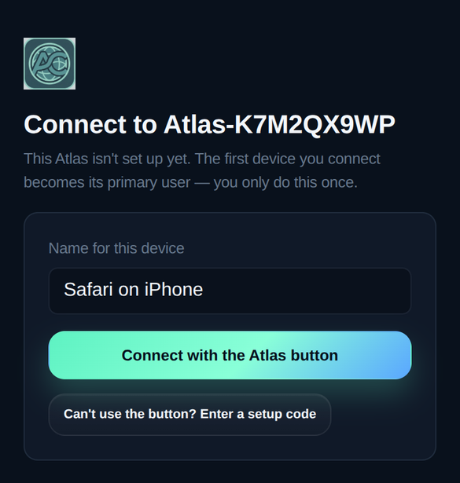

**5. Press the button on Atlas once.** Its light turns a colour. On your
phone, **pick the colour the light is showing**. You get one pick; if you
miss, tap **Start again** and press the button again.

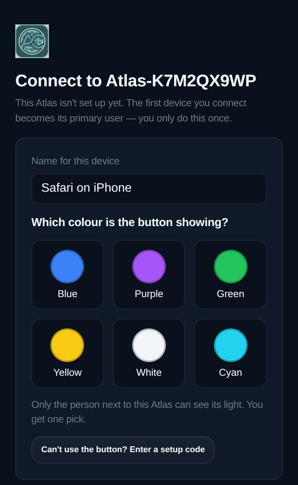

Only someone next to Atlas can see its light, which is why this proves the
phone is yours to connect.

**6. Choose your own Wi-Fi password.** Right after connecting, Atlas asks you
to set a password for its Wi-Fi.

- **Why it matters:** the starting password is the code in the network's
  name, so anyone nearby can work it out. Pick your own (8 characters or
  more) and tap **Save password**.
- **After saving:** phones on Atlas's Wi-Fi, including yours, have to join
  again with the new password.
- **Skip for now:** you can set it later in **Setup → WiFi → Hotspot**.

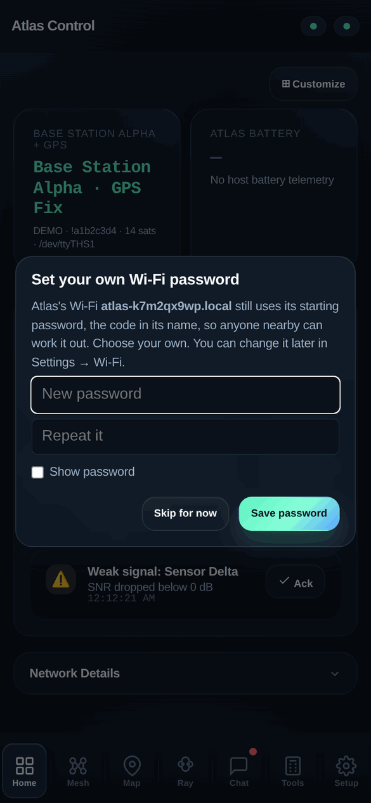

That's it. Your phone stays connected through restarts, updates and changes
of network; you won't be asked again.

**Can't use the button?** If the button doesn't work, or the colours are
hard to tell apart, tap **Can't use the button? Enter a setup code**. Every
Atlas has its own setup code, which you get from Atlas support. The setup
code only works while Atlas has no primary user.

---

## Adding more phones and computers

Once Atlas has a primary user, other devices ask permission:

1. **On the new device:** join Atlas's Wi-Fi (or the network Atlas is on),
   open Atlas and tap **Ask to connect**. It shows a 4-digit code.
2. **On the primary user's phone:** **Allow a new device?** appears with the
   same code, and the button on Atlas blinks blue. If the codes match, tap
   **Allow**; if you don't recognise the request, tap **Don't allow**.

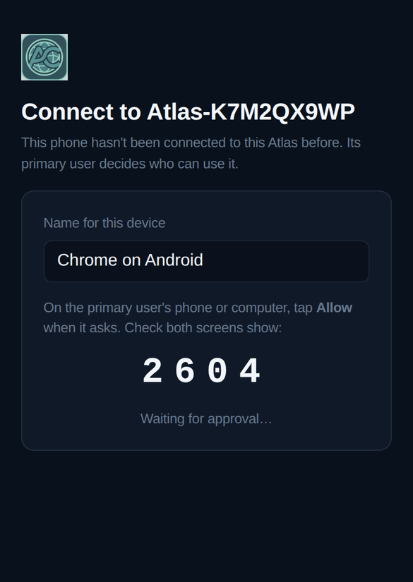
&nbsp;
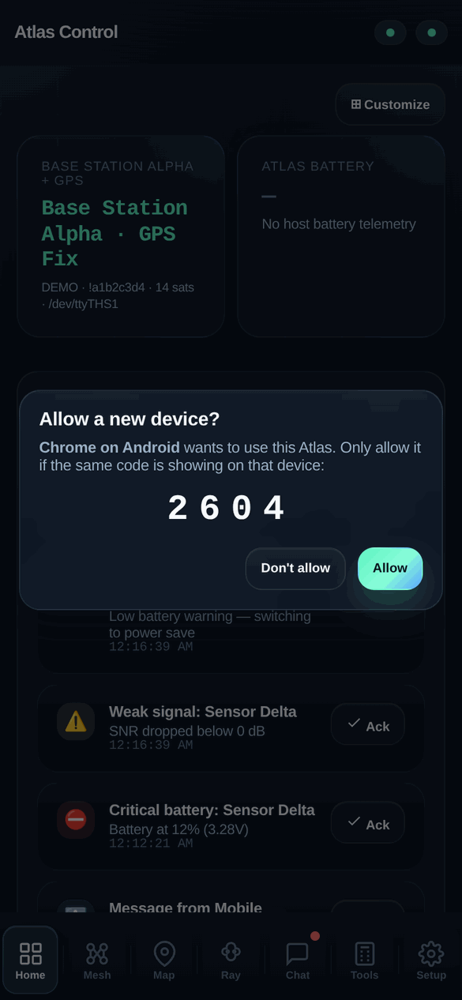

To see or remove connected devices, go to **Setup → Settings → Connected
devices** (shown under [Settings](#settings)). Only the primary user can
allow or remove devices.

---

## Finding your way around

On a phone, the pages are in the bar along the bottom. On a computer,
they're down the left side.

| | Page | What's there |
|---|---|---|
| **Home** | Dashboard | Position, alerts, mesh health at a glance |
| **Mesh** | Your radio network | Every radio heard, its signal and battery |
| **Map** | Maps and navigation | Node map, road directions, hiking trails |
| **Ray** | The assistant | Ask questions, add documents |
| **Chat** | Messages | Channels, direct messages and alerts |
| **Tools** | Calculator and calendar | |
| **Setup** | Wi-Fi, stats and settings | |

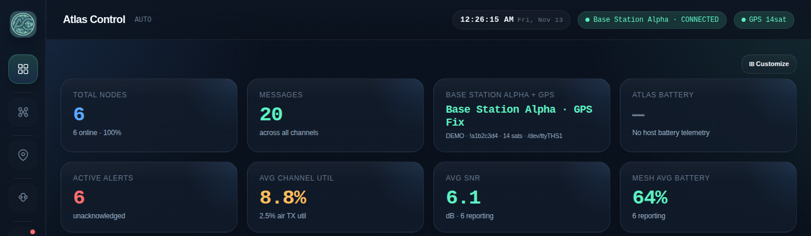

You can reorder or hide pages in **Setup → Settings → Sidebar pages**.

The two dots at the top right of the phone screen show whether the mesh
radio and GPS are working (green: working). On a computer they are spelled
out, for example *GPS 14sat*.

---

## Home

Home gathers what matters right now:
- **Position:** your GPS position and fix quality, with satellites in view.
- **Battery:** Atlas's own battery, if it has one.
- **Alerts:** low batteries, weak signals, new messages. Tap **Ack** to
  acknowledge one, or **View All** to see them all.
- **Network details:** mesh health, phone trackers, battery and signal
  summaries, recent messages.

Tap **Customize** to choose and arrange the cards.

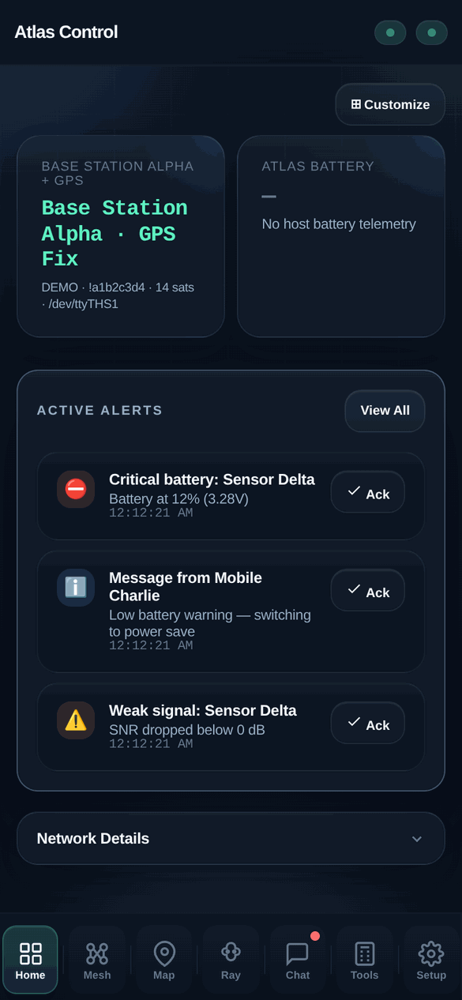

---

## Map, directions and trails

The **Map** page has three views across the top.

**Map (node map).** Shows where your mesh radios are and where Atlas is (the
square). Tick **Topo** for the topographic layer, **GPS Trails** for where
radios have been, and **Phones** for teammates' phones. **Scan Mesh** asks
the radios around you to report in; they appear as they answer.

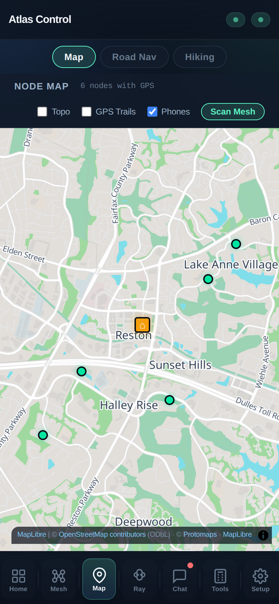

**Road Nav (driving directions).**
1. Search for a place, an address or a city, or type coordinates
   (`38.95, -77.36`).
2. Tap **Go**. Atlas works out the route on the spot, following real roads,
   and guides you turn by turn from your GPS position.
3. It reroutes if you go off course. **Favorites** keeps places you go back
   to.

**Hiking.** **National Park Trails** lists trails by park. Search within
trails, or type coordinates, then **Go**. The topographic map shows the
terrain. Your hikes and favourite places are saved on Atlas.

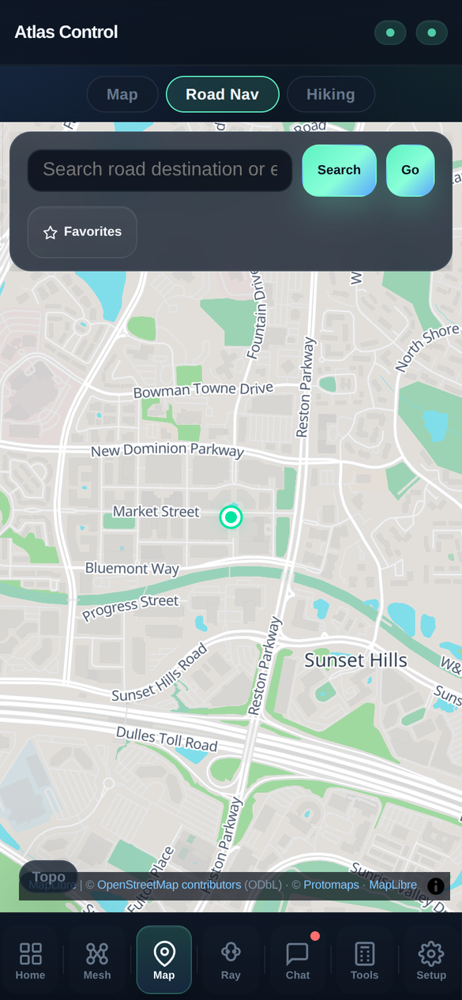
&nbsp;
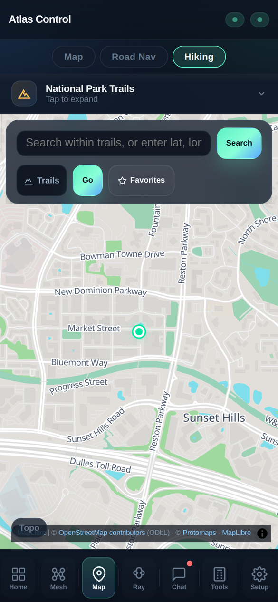

Pinch and drag to move the map. The maps are on Atlas, so they work
anywhere, with no signal.

---

## Mesh

Atlas has a Meshtastic radio. It talks to other Meshtastic radios over long
distances, radio to radio, and messages can hop through other radios to
reach further. The **Mesh** page shows your radio network:

| Tab | What's there |
|---|---|
| **Nodes** | Every radio heard: its role, signal (SNR: higher is better), battery and when it was last heard |
| **Topology** | A diagram of which radios hear which. Tap **Load Topology** |
| **Power** | Battery and power readings the radios report |
| **Location Sharing** | Whether Atlas's position is sent over the mesh, and to whom |

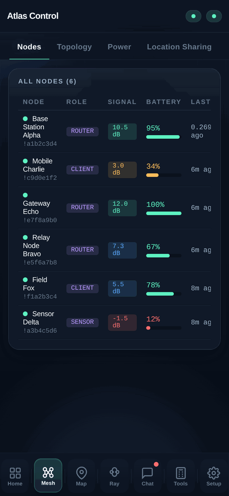

**Your position stays private unless you share it.** Atlas sends its GPS
position over the mesh only if you turn that on (Mesh → Location Sharing, or
Setup → Settings → GPS location sharing). You can broadcast to everyone or
to chosen radios and channels. While sharing is off, the radio's own
automatic position broadcasts are off too.

---

## Messages

**Chat** has two tabs, **Messages** and **Alerts**.

- **Channels** are group conversations every radio on that channel receives.
  **General** is the default. Tap **+** to create a channel for your group,
  or to join one with an invite link from another radio.
- **Direct messages** go to one radio. Tap a name to open the conversation.
  **Rename** gives a radio a name you'll recognise.
- Under each message you see the time, its signal (SNR) and how many hops it
  took.
- **Alerts** lists everything that needs attention: low batteries, weak
  signals, radios gone quiet and messages.

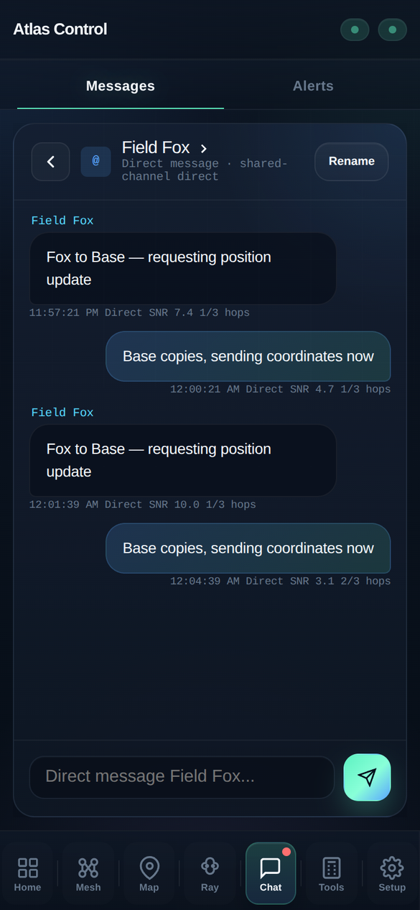

The red dot on **Chat** means unread messages.

---

## Ray, the assistant

Ray is an AI assistant that runs entirely on Atlas: nothing you ask leaves
the device, and it works with no Internet. Type a question and press Enter.
Ray can draw on:
- **Live data:** your position, your mesh radios, their batteries and
  messages.
- **Its built-in library:** first aid, water, shelter, fire, foraging,
  navigation without electronics, radio, off-grid power, vehicles, wildlife
  and more.
- **Your own documents:** anything you add in **Knowledge Base**.

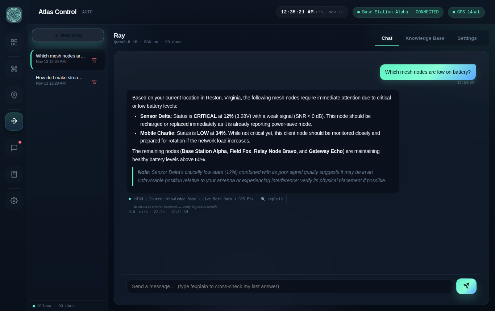

- **Where an answer came from:** shown under it (for example, *Knowledge
  Base + Live Mesh Data + GPS Fix*). Tap **explain**, or type `/explain`, and
  Ray cross-checks its last answer.
- **Accuracy:** AI answers can be wrong. **Check anything important,
  especially medical or safety advice.**
- **Conversations:** **New Chat** starts a fresh one. Past chats are listed
  on the left (on a phone, on Ray's first screen). The bin icon deletes one.
- **Knowledge Base:** add your own documents (a title, tags and the text).
  Ray then uses them in its answers.
- **Settings → Model:** choose Ray's model. **Qwen3.5 4B** is the standard,
  more thorough choice. **Qwen2.5 3B** answers faster. Both are already on
  Atlas, and switching takes a moment.
- **Speed:** the first answer after Atlas starts can take a little longer,
  while Ray loads.
- **How long chats are kept:** 30 days, unless you change it in
  **Setup → Settings → Privacy**.

---

## Tools

- **Calculator:** a scientific calculator. It uses Python-style
  expressions, for example `sqrt(9.8 * 2 * 100)` or `sin(radians(45))`. Your
  recent calculations are listed under it.
- **Calendar:** a month view for planning; events you add stay on Atlas.

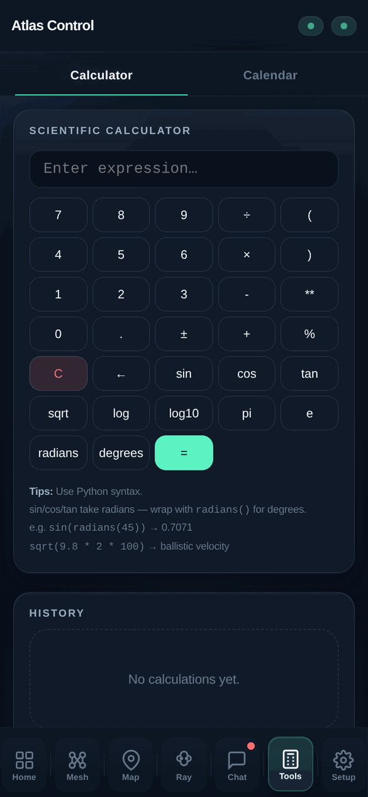

---

## Sharing teammates' phones on the map

Teammates without a mesh radio can still show up on Atlas's map from their
phones:

1. They join Atlas's Wi-Fi (or the network Atlas is on).
2. They open `https://<your Atlas's name>.local/tracker`; Home shows the
   exact link under **Phone trackers**.
3. They enter a name, pick a marker colour and tap **Start Tracking**.
4. The first time, the primary user is asked to **Allow** that phone, just
   like a new device.
5. Their position then shows on **Map** with **Phones** ticked, and on Home.
   **Stop Tracking** ends it.

How long their positions are kept is set in **Setup → Settings → Privacy**.

---

## Wi-Fi: Atlas's own, and joining yours

Atlas makes its own Wi-Fi network wherever it is. You can also connect it to
your home or camp Wi-Fi: then everyone on that network can reach Atlas, and
Atlas can download updates.

**Join a Wi-Fi network:**
1. Go to **Setup → WiFi → WiFi Network**. Atlas lists the networks it can
   see. Tap **Scan** to look again, or **Not in the list? Enter manually**.
2. Tap a network and enter its password.
3. Atlas leaves its own Wi-Fi and joins that network. **Your phone has to do
   the same:** join the same network, then open Atlas again at the same
   address (`https://atlas-xxxxxxxxx.local`).
4. If that address doesn't open (some Android browsers don't understand
   `.local`), use the IP address shown in **Setup → Settings → Local device
   address**. The Atlas app finds Atlas on its own.

If Atlas loses that network, for example when you drive away, it brings its
own Wi-Fi back within about half a minute.

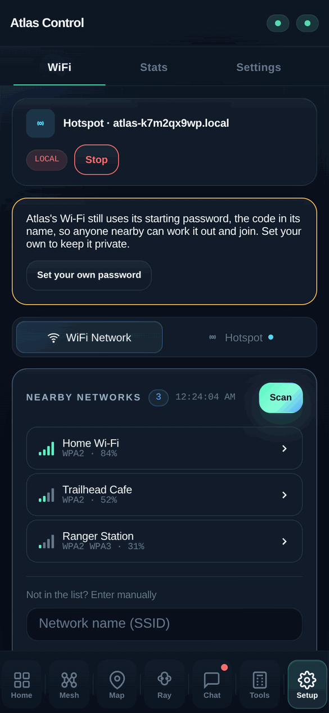

**Atlas's own Wi-Fi (Hotspot).** In **Setup → WiFi → Hotspot** you can change
its name and password (at least 8 characters), then **Save Config**. Phones
connected to it have to join again with the new details. Until you choose
your own password, a reminder shows at the top of this page.

---

## Settings

**Setup → Settings** holds everything else.

| Section | What it does |
|---|---|
| **Local device address** | Atlas's name, its `.local` address and its current IP address, with Copy buttons. |
| **Dashboard** | Refresh rate, date format, **units** (imperial or metric) and **time zone**. |
| **Nodes, Alerts** | When a radio counts as online; battery and silence alert levels. |
| **Personalization** | Dark or light theme; which pages show, and their order. |
| **Device configuration** | The mesh radio's own settings. |
| **GPS location sharing** | Off, broadcast to all, or chosen radios and channels. |
| **Connected devices** | Who can use Atlas. The primary user can remove any device. This also says whether the Atlas button is working. |
| **Privacy** | How long Ray chats, Ray's sources, location history and shared phones are kept; buttons to delete history now; the security log. |
| **Software update** | The installed version, and **Check for Updates**. |
| **Danger zone** | Factory reset. |

After changing the dashboard, node, alert or personalization settings, tap
**Save Settings** at the bottom. GPS sharing has its own **Apply** button.

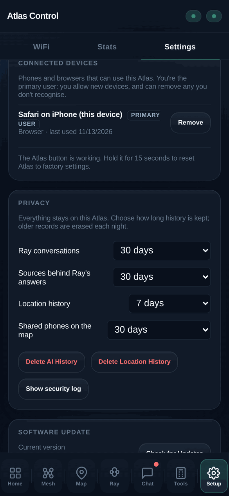
&nbsp;
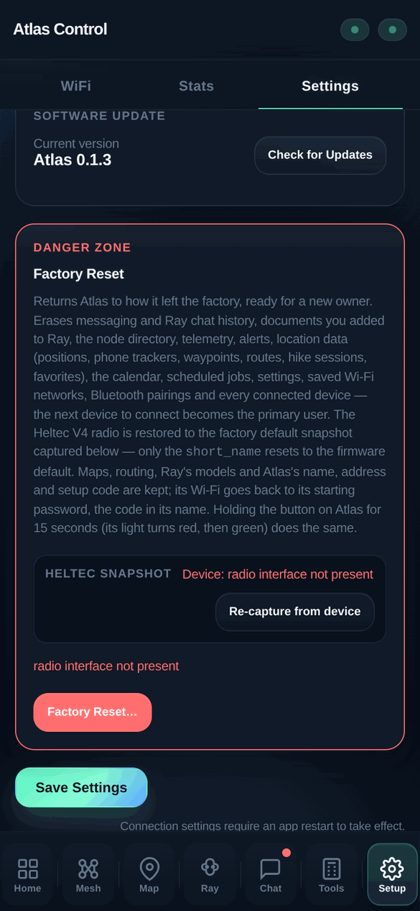

**Setup → Stats** shows how hard Atlas is working: processor, memory,
storage, temperatures and power use.

---

## Updates

Atlas updates itself whenever it is on a Wi-Fi network with Internet access:
- **When it checks:** every six hours. **Setup → Settings → Software
  update → Check for Updates** checks now.
- **What you see:** the new version and what's new, a progress bar while it
  installs, and Atlas restarts on its own.
- **Safety:** every update is signed and checked before it installs. If an
  update doesn't start properly, Atlas goes back to the previous version by
  itself, even after a power cut.
- **What you keep:** your settings, messages, chats and connected devices.

---

## Factory reset: starting over or passing Atlas on

A factory reset returns Atlas to how it left the factory, ready for a new
owner.

**It erases:**
- Messages, alerts and the radio directory.
- Ray's chats and the documents you added.
- All location data: positions, phone trackers, waypoints, routes, hikes and
  favourites.
- The calendar.
- Your settings.
- Saved Wi-Fi networks and Bluetooth pairings.
- **Every connected device.**

**It keeps:** the maps, routing, Ray's models, and Atlas's name, address and
setup code. Its Wi-Fi goes back to the starting password, the code in its
name.

Two ways to do it:

- **From a connected phone:** **Setup → Settings → Danger zone → Factory
  Reset…**, then confirm.
- **On Atlas itself:** hold the button for **15 seconds**. The light turns
  red; keep holding until it turns green. When it's done, the light glows
  dim white again.

The button works without any phone. It's how you get back in if you can't
connect at all, for example if you forgot the Wi-Fi password you set. The
next device to connect becomes the primary user.

---

## Troubleshooting

| Problem | What to do |
|---|---|
| I can't find Atlas's Wi-Fi | Give Atlas two minutes after turning it on. If Atlas has joined another network, its own Wi-Fi is off: use that network, or wait about half a minute after moving out of its range. |
| I forgot the Wi-Fi password I set | Connect through another network Atlas is on, if you can. Otherwise, hold the button for 15 seconds (this erases Atlas: see [Factory reset](#factory-reset-starting-over-or-passing-atlas-on)). |
| `https://atlas-….local` doesn't open | Use `https://10.42.0.1` on Atlas's own Wi-Fi, or the IP address in Setup → Settings → Local device address. Some Android browsers don't understand `.local` names. The Atlas app finds Atlas by itself. |
| The browser says the connection isn't private | Expected the first time: Atlas uses its own certificate. Choose to continue (see [step 3](#setting-up-connect-your-phone)). |
| I picked the wrong colour | Tap **Start again** and press the button once more. |
| The button's colours are hard to tell apart | Use **Enter a setup code** with the code from Atlas support (only while Atlas has no primary user). |
| A new phone can't connect | The primary user has to tap **Allow** on their phone. If the primary user's phone is lost, a factory reset (button, 15 seconds) lets you start again. |
| No GPS position | GPS needs a view of the sky; the first fix can take a few minutes outdoors. |
| Mesh shows no radios | Other radios must be on the same channel settings. Check Setup → Settings → Device configuration. |
| Ray is slow | The first answer after a restart loads the model. **Qwen2.5 3B** (Ray → Settings) answers faster. |
| The map is blank | Wait a moment and zoom in or out; on older phones, large maps take a few seconds to draw. |
